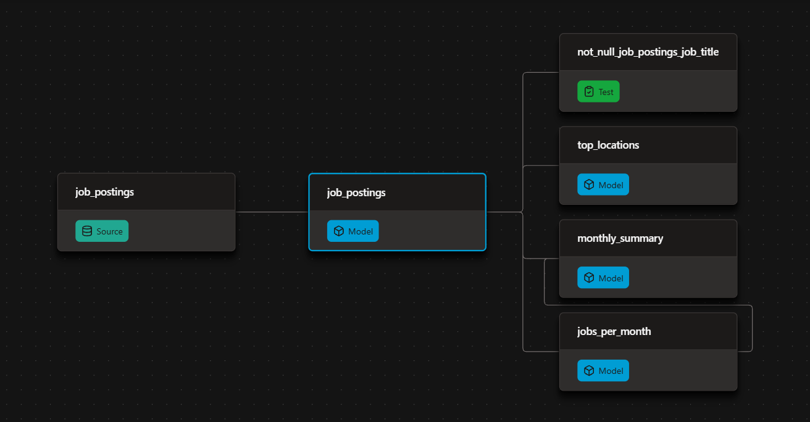

# Automated Job Postings Pipeline (v1) - dbt + DuckDB


An automated, open-source **dbt + DuckDB** analytics pipeline processing ~692k real job postings. Every push to `main` and every Monday rebuilds the models, runs data quality tests, and publishes both the documentation site and the finished DuckDB database automatically. 

- Transforms raw job posting data into clean staging views and tested analytical marts.
- Publishes the compiled DuckDB warehouse as a GitHub Release so anyone can query it directly without cloning the repo or needing credentials.
- Uses GitHub Actions and `uv` to validate, test, and deploy changes automatically.
> **v1 of this pipeline** - everything free and local-friendly: DuckDB as the warehouse, GitHub Actions as the scheduler. [v2](../project_2/) rebuilds it production-grade on Databricks.

| Component | Implementation | Location |
| --- | --- | --- |
| **dbt Pipeline** | sources → cleaned models → insight marts | [`analytics/models/`](analytics/models/) |
| **Data Tests** | `unique` / `not_null` on every mart grain | [`schema.yml`](analytics/models/schema.yml) |
| **Hosted dbt Docs** | Lineage, descriptions, column tests | [Live docs site](https://davidcruzm.github.io/dbt-duckdb-pipeline/) |
| **Public CI** | Build + test + publish on every push | [Actions workflow](https://github.com/davidcruzm/dbt-duckdb-pipeline/actions) |
| **Environments** | local `dev` vs CI `prod` targets | [ci/profiles.yml](ci/profiles.yml) |
| **Published Warehouse** | one `ATTACH`, queryable by anyone | [Query it](#query-the-published-warehouse) |

---

## ⚙️ The dbt Pipeline

Raw job postings flow through three distinct layers—declared sources, cleaned staging views, and aggregated marts—with automated tests verifying the data before anything ships. The DAG below is the whole flow:




| **dbt Feature** | **How I Used It** |
| --- | --- |
| **Sources** | Eliminates hardcoded file paths using [`source.yml`](analytics/models/source.yml) and `{{ source('raw', 'job_postings') }}` |
| **Lineage (`ref`)** | Connects downstream marts via `{{ ref() }}` so dbt automatically resolves execution order |
| **Materializations** | Project default `table`; staging override to `view` |
| **Data Tests** | `unique` / `not_null` on mart grains in [`schema.yml`](analytics/models/schema.yml) |
| **Environments** | Isolates local development (`dev.duckdb`) from automated CI production builds (`prod.duckdb`) via [ci/profiles.yml](ci/profiles.yml) |

`dbt build` compiles SQL, materializes models and fails the run if any test fails - same command locally and in CI.

---

## 🚀 Production

GitHub Actions runs the whole pipeline - no laptop required: [`.github/workflows/dbt_build.yml`](.github/workflows/dbt_build.yml)

| **Trigger** | **What happens** |
| --- | --- |
| **Push to `main`** | Full rebuild |
| **Weekly (Monday)** | Scheduled rebuild - pipeline stays fresh |
| **Manual (`workflow_dispatch`)** | Run button in the Actions UI |

On each run, Actions:

1. Sets up the Python environment and dependencies using **`uv`**.
2. Downloads raw parquet dataset.
3. Runs `dbt build` with the committed CI profile (prod)
4. Publishes `prod.duckdb` as a GitHub Release asset

The badge at the top of this README links to the latest runs.

---

## 🦆 Query the published warehouse

You don't need to clone this repository or set up Python to explore the finished marts. Install the [DuckDB CLI](https://duckdb.org/docs/installation/) (`winget install DuckDB.cli` on Windows or `brew install duckdb` on macOS), open a terminal session, and attach the remote database directly:

```sql
INSTALL httpfs;
LOAD httpfs;

ATTACH 'https://github.com/davidcruzm/dbt-duckdb-pipeline/releases/download/warehouse/prod.duckdb' AS jobs;
USE jobs;
SHOW TABLES;

SELECT * FROM top_locations;
SELECT * FROM monthly_summary;
```

## 📖 Docs

Docs are generated with `dbt docs generate` and published to GitHub Pages:

→ **[davidcruzm.github.io/dbt-duckdb-pipeline/](https://davidcruzm.github.io/dbt-duckdb-pipeline/)**

The site shows:

- The full **lineage graph** (sources → models → marts)
- **Model and column descriptions** from the YAML
- Which columns carry **tests**

---

## 💻 Run it yourself

``` bash
uv sync
uv run python scripts/download_data.py
cd analytics && uv run dbt build
```

Optional docs locally:

``` bash
uv run dbt docs generate
uv run dbt docs serve
```